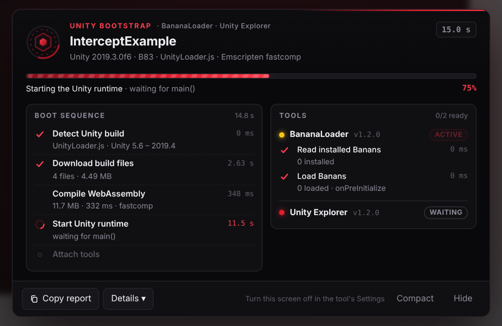
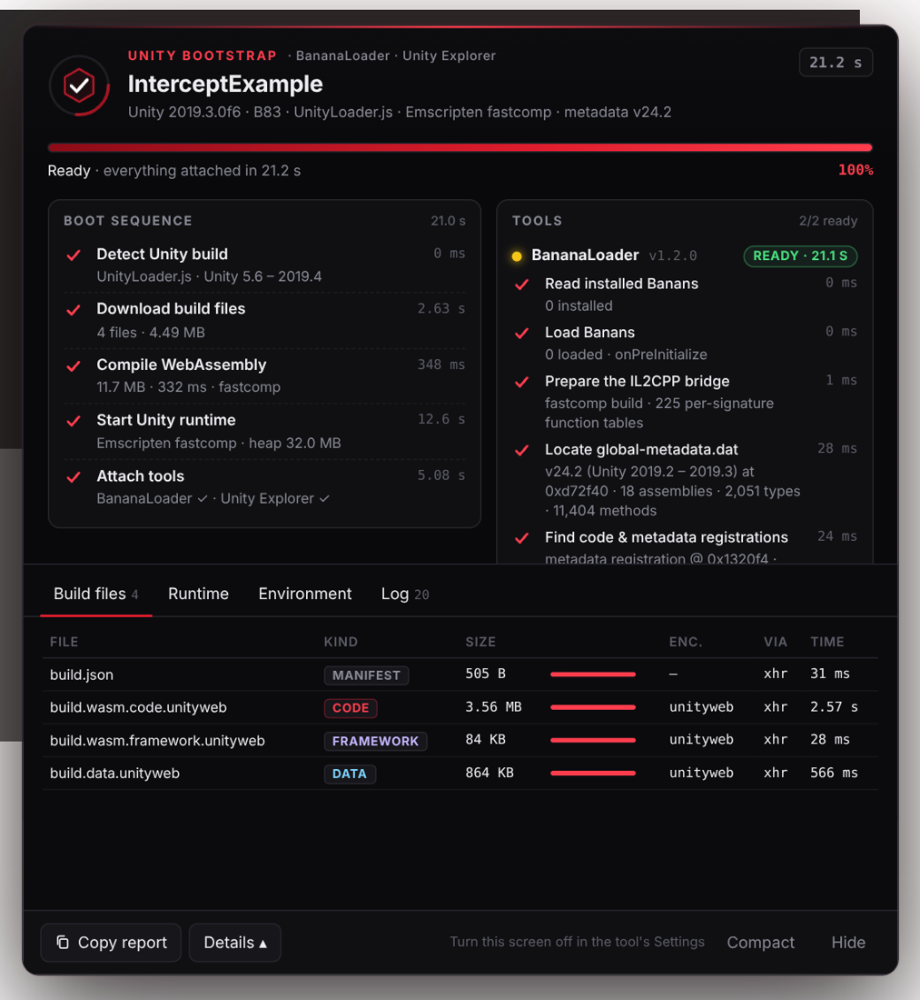
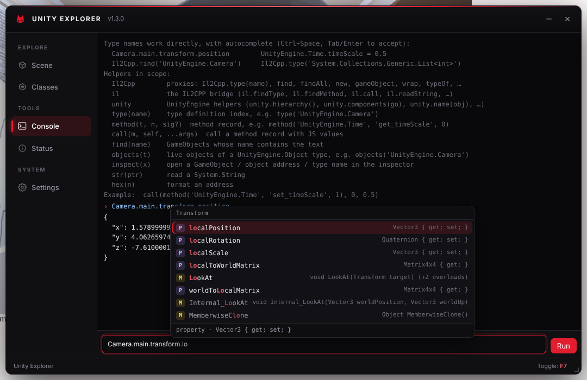

<div align="center">


# Unity Explorer

**A runtime explorer for Unity WebGL games. Browse the scene, inspect any object, edit fields live and call methods, straight from a userscript.**


</div>

## Table of Contents

- [Features](#features)
- [Screenshots](#screenshots)
- [Install](#install)
- [Bootstrap](#bootstrap)
- [Using it](#using-it)
- [Typing values](#typing-values)
- [Console](#console)
- [How it works](#how-it-works)
- [Compatibility](#compatibility)
- [Limitations](#limitations)
- [Building](#building)
- [Project structure](#project-structure)
- [Changelog](#changelog)
- [Credits](#credits)
- [License](#license)

## Features

- **Scene hierarchy.** Every GameObject in a searchable tree, with inactive and hidden objects marked and prefabs that aren't in a scene grouped separately.
- **In-game picker.** Click an object in the game view and it's selected in the tree. Works for UI elements, 3D colliders (camera raycast) and 2D colliders.
- **GameObject view.** Rename, toggle active, destroy, edit position, rotation and scale, enable or disable components, and jump to children.
- **Inspector.** Fields, properties and methods of any object, grouped by class with inherited members included. Values update live.
- **Live editing.** Numbers, strings, bools, enums (as a dropdown), vectors and other small structs, and object references.
- **Collections.** Arrays, `List<T>` and `Dictionary<K,V>` expand inline or open in an Elements tab.
- **Method calls.** Call any non-generic method, static or instance. `ref` and `out` results are shown, and returned objects can be opened. Managed exceptions are caught and shown as text instead of crashing the game.
- **Class browser.** Every type in every assembly, with static fields, static properties and methods, constants, enum values and nested types. **Instances** finds live objects of a type.
- **Console with IntelliSense.** A JavaScript REPL where type names work directly (`Camera.main.transform.position`), with autocomplete for types, namespaces, static and instance members, struct fields, enum values and method signatures. See [Console](#console).
- **Odium UI.** A black-and-red window that you can drag and resize, toggled with <kbd>F7</kbd>. Keystrokes typed into it never reach the game.
- **Unity 2018.1 to 6000.** Every IL2CPP metadata version from v24.0 to v31, and both of Unity's WebGL toolchains: the old Emscripten fastcomp (asm2wasm) builds of Unity 2018 to 2021.1, and the LLVM builds of 2021.2 onwards. Both the `UnityLoader.js` loader (up to 2019.4) and `createUnityInstance` (2020.1+) are supported.
- **Bootstrap loading screen.** While the game loads, an animated loading screen shows each boot phase, the build files downloading, the WebAssembly compile, every IL2CPP attach step and a full log. See [Bootstrap](#bootstrap).

## Screenshots

| | |
| --- | --- |
|  **Inspector**: fields of a component, with static members and constants |  **Methods**: call with arguments and see the result |
|  **Classes**: search every type, its statics and its memory layout |  **Console**: script the game from JavaScript |

## Install

1. Install a userscript manager, either [Tampermonkey](https://www.tampermonkey.net/) or [Violentmonkey](https://violentmonkey.github.io/).
2. Open `dist/unity-explorer.user.js` and install it.
3. Load a Unity WebGL game. The window appears once the game has started. Press <kbd>F7</kbd> to show or hide it.

The script matches every site, but it only shows up on pages that run a Unity WebGL build. To limit it to one game, change `@match` in the header, for example `// @match https://example.com/game/*`.

> [!TIP]
> The script runs at `document-start` so it can attach to the game as it boots. If it's injected later, it still finds the running game through the usual globals (`unityInstance`, `gameInstance` and so on).

## Bootstrap

A bootstrap runs first, at `document-start`, before the game's own scripts. It watches the game load, shows a loading screen while it does, and only then hands over to the explorer. If Unity Explorer and BananaLoader are both installed, they share one bootstrap and one loading screen, and each shows up as a tool with its own steps.

| | |
| --- | --- |
|  **Loading**: boot phases, live progress, and each tool's steps as they attach |  **Details**: every build file, the runtime, the environment and a log |

The loading screen shows:

- **Boot sequence.** Detect the Unity build, download the build files, compile the WebAssembly, start the Unity runtime, attach the tools. Each phase has its timing and what it found (loader API, file count and size, wasm size and compile time, Emscripten toolchain, heap size).
- **Tools.** Every IL2CPP step, timed, with its result: the metadata version and which Unity versions use it, where the registrations are, the calibrated `Il2CppClass` / `MethodInfo` layout, the calling convention, how many engine methods survived stripping, and the tool's own steps.
- **Details** (click **Details**):
  - **Build files**: every build file with its kind, size, live progress, encoding, `fetch` or `XHR`, and timing.
  - **Runtime**: product, company, Unity version, loader, toolchain, wasm size and compile mode, memory, function table, import/export counts and the wasm analysis.
  - **Environment**: browser, threads, RAM, cross-origin isolation and BigInt support.
  - **Log**: a timestamped log of everything above.
- **Copy report** puts all of it on the clipboard as text, for bug reports.

When everything is attached, the screen folds into a small pill in the corner and fades out, and the tool's window appears. You can open the window earlier with its hotkey. If something fails, the screen turns into a corner card that says what went wrong, so it never covers a game that is running. The dimmed backdrop never blocks clicks. Under **Settings → Loading screen** you can switch to a corner card or turn the screen off. **Show loading screen** brings it back.

The bootstrap only observes, and it runs on every page, so it follows three rules:

1. **Every call goes through unchanged.** The page gets its own promises and `Response` objects. Download progress and the wasm bytes are read from clones, so URLs, caching and the browser's compiled-code cache behave as they normally would.
2. **Nothing beyond pass-through until there's proof of Unity.** That means a call to a Unity loader, or an Emscripten `Module` that belongs to Unity. Other wasm libraries on the page (Draco, Basis, physics engines) are told apart from the game.
3. **The bootstrap's own bookkeeping can never throw into the page.**

On pages without Unity, the one global hook (`Object.prototype.asm`) is removed a few seconds after the page loads, and nothing is shown.

| It hooks | To learn |
| --- | --- |
| `UnityLoader.instantiate` (Unity 5.6 – 2019.4) and `createUnityInstance` (2020.1+) | which loader, the build config, Unity's own progress, the game instance |
| `fetch` and `XMLHttpRequest`, for build files only | file sizes, encodings, download progress, the `Build/*.json` manifest |
| `WebAssembly.instantiate` / `instantiateStreaming` | compile time, the module's memory and function table, and the wasm bytes (analysed for exact function signatures) |
| `Module.asm` and `Module.postRun` | when the Emscripten runtime has its exports, and when `main()` has run |

## Using it

**Scene**: pick a GameObject on the left.
- The right side shows its transform, its components (click one to inspect it) and its children.
- **Object** opens the GameObject's own managed fields and methods.
- The eye button shows hidden objects. Refresh rebuilds the tree after the game loads a new scene.
- The target button picks an object from the game itself. Hover the game to outline what's under the cursor, with its name and type, then click to select it. It checks, in order, UI graphics (topmost canvas first), a `Physics.Raycast` from the main camera, then `Physics2D.OverlapPoint`. <kbd>Esc</kbd> or right-click cancels.

**Inspector**: the tabs are **Fields**, **Properties**, **Methods** and, for collections, **Elements**.
- Members are grouped by the class that declares them.
- Click a type name to open its static view. Click an object reference to follow it, and use the arrows or the breadcrumb to go back.
- Edit a value and press <kbd>Enter</kbd>; <kbd>Esc</kbd> cancels.
- The clock button pauses live updates.

**Properties** run a getter, which is game code. By default, getters on engine types (`UnityEngine.*`, `System.*`, `TMPro.*`) are evaluated automatically, while getters on game types wait for you to click **Get**. You can change this under **Settings → Inspector**.

**Classes**: search by name, optionally limited to one assembly (`Assembly-CSharp` is selected first).
- **Instances** lists live objects of the type.
- **Init** runs the static constructor of a class that hasn't been loaded yet.
- **Instance members** lists the declared layout, with field offsets.

**Status** shows what was detected. **Copy diagnostics** puts a report on your clipboard for bug reports.

## Typing values

| Type | Examples |
| --- | --- |
| numbers | `42`, `-1.5`, `0x1F` |
| `bool` | `true`, `false`, `1`, `0` |
| `string` | `hello`, `"quoted text"`, or `null` |
| enums | `Skybox`, `Fire \| Reload`, or the number |
| small structs (`Vector3`, `Color`, `Rect`, …) | `1, 2, 3`, comma or space separated, in field order |
| object references | `null`, or an address such as `@0x02700EC0` (click an address chip to copy it) |
| `System.Type` | a type name: `UnityEngine.Camera` |
| `out` parameters | leave empty |

## Console

The console evaluates JavaScript. Game types can be used by name, like in C#:

```js
Camera.main.transform.position                      // { x: 1.58, y: 3.9, z: -7.61 }
Time.timeScale = 0.5
UnityEngine.SceneManagement.SceneManager.sceneCount // namespaces work too
Il2Cpp.find('UnityEngine.Camera').fieldOfView = 90  // first live object of a type
Il2Cpp.new('System.Collections.Generic.List<int>')  // construct, generics included
```

A bare name resolves to the matching type, preferring `UnityEngine`, then the game's own assemblies (`Assembly-CSharp`), then `System`. Names that JavaScript already defines (`Object`, `Math`, `JSON`, …) keep their JavaScript meaning; use the namespace or `Il2Cpp.type('UnityEngine.Object')` for those.

### IntelliSense

Completions come up as you type:



| You type | You get |
| --- | --- |
| `Camera.` | static members of `UnityEngine.Camera`: `main`, `allCameras`, `GetAllCameras(…)`, nested types |
| `Camera.main.` | instance members of `Camera`, including the ones inherited from `Behaviour`, `Component` and `Object` |
| `Camera.main.transform.position.` | struct fields: `x`, `y`, `z` |
| `KeyCode.` | enum values with their numbers |
| `UnityEngine.` | namespaces and types |
| `Il2Cpp.type('Cam` | full type names (also inside `find`, `new`, `typeOf`, `$is`, `$component`, `.of`) |
| `Il2Cpp.method('UnityEngine.Time::` | members of that type, accessors included |
| `transform.Translate(` | the overloads, with the current parameter underlined |
| `const t = Il2Cpp.find('UnityEngine.Transform');` then `t.` | members of `Transform`: `const`/`let` declarations are followed |

Member types are followed through fields, property getters and method return types, with generic arguments filled in (`Dictionary<string, GameObject>.Values` → `ValueCollection<string, GameObject>`). <kbd>Tab</kbd> or <kbd>Enter</kbd> accepts, <kbd>↑</kbd>/<kbd>↓</kbd> choose, <kbd>Esc</kbd> closes, <kbd>Ctrl</kbd>+<kbd>Space</kbd> opens the list anywhere.

Completion is static: it reads the IL2CPP metadata and never calls a getter or method while you type. It only lists what the build contains, so members that Unity stripped from a build (for example `Camera.main` in a game that never uses it) aren't offered and are `undefined` at runtime.

### Helpers

```js
Il2Cpp                                              // proxies: type, find, findAll, new, gameObject, wrap, typeOf, string, ref
type('UnityEngine.Camera')                          // type definition index
method('UnityEngine.Time', 'set_timeScale', 1)      // method record (name + parameter count or types)
call(method('UnityEngine.Time', 'set_timeScale', 1), 0, 0.5)   // static call: self = 0
find('Player')                                      // GameObjects whose name contains "Player"
objects('UnityEngine.Camera')                       // live objects of a UnityEngine.Object type
inspect(Camera.main)                                // open in the inspector (proxies or addresses)
str(ptr)                                            // read a System.String
il, unity                                           // the full bridge, see src/il2cpp
```

`Il2Cpp` is the same interop layer BananaLoader gives Banans: objects are proxies whose fields, properties and methods are accessed by name, and structs are plain `{ x, y, z }` objects.

The same objects are available on the page as `window.UnityExplorer` (`.il`, `.unity`, `.inspect()`).

## How it works

Unity WebGL builds strip the `il2cpp_*` API, so the explorer works from the build's own data:

1. **Bootstrap.** The `document-start` [bootstrap](#bootstrap) catches the Unity loader, the WebAssembly instance and the Emscripten `Module` (when the framework assigns `Module.asm`). That gives access to the wasm memory, the function table, `malloc` and the stack helpers. It also keeps the wasm bytes and works out each table slot's exact function type.
2. **Metadata.** The runtime keeps `global-metadata.dat` in the heap. It's found by its `0xFAB11BAF` magic and supplies the names of every assembly, type, field, method, parameter and property. The header only says "24" for five different layouts, so the sub-version (24.0, 24.1, 24.2+) comes from the header size and the record sizes, which also decide which optional fields each record has. Layouts v27, v29, v31 and v38+ are worked out the same way.
3. **Registrations.** `Il2CppCodeRegistration` maps methods to code:
   - Unity 2019.2 and later have one code module per assembly, found through the `mscorlib.dll` name, that maps each method token to its function.
   - Unity 2018 has a single flat `methodPointers` array, indexed by each method's `methodIndex`.

   `Il2CppMetadataRegistration`, found by its shape, holds every `Il2CppType`, the field offsets and the type sizes.
4. **Calibration.** The bridge allocates a `System.String`, then locates `name`, `parent`, `fields`, `static_fields`, `methods` and the class table inside `Il2CppClass` by matching what it already knows about `String`, `String.Empty` and `Object`. It works out the `MethodInfo` layout the same way: it changed in Unity 2021.2, when `virtualMethodPointer` was added and the parameter list became a plain type array. It also finds where `Il2CppType` keeps its `byref` bit, which moved in metadata 27.2. Nothing is hard-coded per Unity version.
5. **Calls.** Managed methods are called directly through the function table using IL2CPP's convention: `(sret?, this?, ...args, MethodInfo*)`.
   - On LLVM builds (2021.2+) a method pointer *is* its table index. Structs follow the wasm32 C ABI: passed by pointer, except single-field structs, which are passed by value.
   - On fastcomp builds (2018 – 2021.1), every function signature has its own sub-table inside the wasm table, and a method pointer is relative to it. The bridge reads each sub-table's offset and mask out of the build's `dynCall_*` functions. It resolves a method as `offset + (pointer & mask)` and never lands on fastcomp's `abort()` placeholders. It also handles three quirks of those builds:
     - structs are always passed by pointer, but one-field structs are returned by value;
     - the optimizer drops `MethodInfo*` from methods that never read it (`Math.Sqrt` becomes `double(double)`);
     - until Unity 2018.3, static methods took an unused leading `this`.
   - `long` is passed as a BigInt. If a build splits it into two 32-bit halves, the bridge does the same.
   - The function's arity is checked before every call.
   - Managed exceptions arrive as C++ throws; they're caught, the stack pointer is restored, and the exception's message is read.
6. **Scene.** GameObjects come from `FindObjectsOfType`, `FindObjectsByType` or `Resources.FindObjectsOfTypeAll`, whichever survived stripping. A heap scan is the last resort.

## Compatibility

Works with Unity **2018.1 through 6000.x** WebGL builds that use WebAssembly. That covers IL2CPP metadata v24.0 through v31, both Emscripten toolchains and both Unity loaders:

| Unity | Metadata | Toolchain | Loader | Notes |
| --- | --- | --- | --- | --- |
| 2018.1 – 2018.2 | v24.0 | fastcomp | `UnityLoader.js` | flat method table; static methods take a dummy `this` |
| 2018.3 – 2019.1 | v24.1 | fastcomp | `UnityLoader.js` | flat method table |
| 2019.2 – 2019.4 | v24.2 – 24.4 | fastcomp | `UnityLoader.js` | per-assembly code modules |
| 2020.1 | v24.4 | fastcomp | `createUnityInstance` | |
| 2020.2 – 2021.1 | v27 | fastcomp | `createUnityInstance` | `byref` bit moves in 27.2 |
| 2021.2 – 2023.1 | v29 | LLVM | `createUnityInstance` | `MethodInfo` gains `virtualMethodPointer` |
| 2023.2 – 6000.2 | v31 | LLVM | `createUnityInstance` | |

asm.js builds (an option in Unity 2018 and earlier) have no function table to call into. The loading screen reports them as unsupported.

Tested end to end in headless Chromium, with both tools, on public WebGL builds from each era. For each build, every method's resolved function was also checked against the build's own wasm: for example, `Math.Sqrt` has to land on a function containing `f64.sqrt`.

| Test build | Unity | Metadata | Toolchain · loader | Checked |
| --- | --- | --- | --- | --- |
| MaskShader | 2018.2.6f1 | v24.0 | fastcomp · `UnityLoader.js` | static `this` detected; string, float, int and `out` calls; generic types |
| apartment | 2018.3.6f1 | v24.1 | fastcomp · `UnityLoader.js` | 502 GameObjects via `FindObjectsOfType`, transforms, components, a BananaLoader patch |
| InterceptExample | 2019.3.0f6 | v24.2 | fastcomp · `UnityLoader.js` | calls, generic types, both tools on one page |
| HealthBarExample | 2020.1.6f1 | v24.2 | fastcomp · `createUnityInstance` | 81 GameObjects (verified heap scan), components |
| unity-webgl-deploy | 2020.3.9f1 | v27 | fastcomp · `createUnityInstance` | attach, calls, generic types |
| SpaceTest | 2021.3.14f1 | v29 | LLVM · `createUnityInstance` | attach, calls, `out` parameters |
| UVMapping | 2023.1.18f1 | v29 | LLVM · `createUnityInstance` | attach, calls, `out` parameters |

The 2018.3 build was also tested with the userscript injected after the game had started. Most of these demos strip whatever engine APIs they don't use, so some scene features depend on what a game kept.

## Limitations

- **Pages that were already running before the userscript.** If the userscript is injected after the game has loaded, the bootstrap can't see the wasm compile, so it downloads the wasm again from the browser cache. On fastcomp builds (Unity 2018 – 2021.1), method calls need what it learns from that file.
- **Generic methods and methods of generic types** (`List<T>.Add`) are listed but can't be called. Their code lives in shared generic tables that aren't mapped yet.
- **Stripped code can't be called.** If the game never used a method, the build doesn't contain it, and the inspector says so. Engine helpers fall back automatically.
- **Generic struct parameters** (`Nullable<T>`, `KeyValuePair<K,V>`) aren't supported as arguments. They can still be read.
- **Thread-static fields** aren't shown.
- **Property getters and method calls run game code.** They can have side effects, and a bad argument can throw (which is caught) or, rarely, trap the wasm.
- **Encrypted metadata.** Builds that encrypt their metadata still work as long as it's decrypted in memory, which it has to be for the game to run. Builds that rewrite the metadata format won't.

## Building

The build needs [Bun](https://bun.sh/) and nothing else:

```bash
bun scripts/build.js             # minified -> dist/unity-explorer.user.js + dist/unity-explorer.js
bun scripts/build.js --readable  # unminified, for debugging
```

`dist/unity-explorer.js` is the same code without the userscript header. It's useful for injecting from the console or from another script before the game loads.

## Project structure

```
unity-explorer/
├── src/
│   ├── main.js            app: window, tabs, status, settings
│   ├── hook.js            key shield (keystrokes in the window never reach the game)
│   ├── bootstrap/         document-start bootstrap and loading screen (shared with BananaLoader)
│   │   ├── index.js       getBootstrap(), prepareIl2Cpp()
│   │   ├── core.js        state, phases, tool steps, the text report
│   │   ├── hooks.js       Unity loaders, build files, WebAssembly, Module.asm / postRun
│   │   ├── modal.js       the loading screen
│   │   └── modal.css
│   ├── il2cpp/
│   │   ├── memory.js      heap views and scanning
│   │   ├── metadata.js    global-metadata reader (v24.0 – v39)
│   │   ├── registration.js  code / metadata registration finder (per-module and flat)
│   │   ├── runtime.js     the bridge: types, classes, fields, calls, strings, ABI per toolchain
│   │   ├── unity.js       UnityEngine helpers with fallbacks for stripped APIs
│   │   ├── values.js      value formatting and input parsing
│   │   ├── interop.js     Il2Cpp proxies: objects, types, structs, generics (shared with BananaLoader)
│   │   ├── typeindex.js   type names, namespaces, bare names for the console
│   │   ├── complete.js    IntelliSense engine (static: metadata only)
│   │   └── types.js       Il2CppTypeEnum and attribute flags
│   ├── ui/
│   │   ├── scene.js       hierarchy tree + inspector
│   │   ├── picker.js      click-to-select in the game view
│   │   ├── classes.js     type browser + static inspector
│   │   ├── inspector.js   fields / properties / methods / elements
│   │   ├── console.js     JavaScript REPL
│   │   ├── complete.js    autocomplete popup and signature help for any textarea
│   │   ├── vlist.js       virtualised list
│   │   ├── icons.js       line icons
│   │   └── explorer.css
│   └── odium/             Odium UI (vendored)
├── scripts/build.js
├── userscript.config.json userscript header
└── dist/
```

## Changelog

### 1.3.2

- **Fix: turning a GameObject off didn't work on many builds.** Unity strips `GameObject.SetActive` from builds whose game never calls it, and the toggle failed quietly there. Now:
  - With `SetActive` (most real games), it's used as before. If the game turns the object straight back on, you're told instead of the switch silently flipping back.
  - Without it, the Renderers, Colliders and Behaviours on the object and its children are disabled instead, and exactly those are re-enabled when you turn it back on. A notice says this happened.
  - If the build has neither, the error says why.
- **Fix: the active switch could show "off" for an active object** when the build strips `get_activeSelf`, so clicking it tried to turn the object *on*. The state now falls back to what was last set, then `activeInHierarchy`.
- **Fix: objects you turned off disappeared from the scene tree** on builds that can only list active objects, so they couldn't be turned back on. They (and their children) now stay listed.

### 1.3.1

- **Fix: the userscript failed to load** with `Invalid regular expression: … Range out of order in character class`. The minified build contained a literal U+FFFF character, which some userscript managers mangle when they inject the script. The identifier pattern is now ASCII-only, and the build escapes every non-ASCII character, so the output is plain ASCII.

### 1.3.0

- **IntelliSense in the console.** Autocomplete for type names, namespaces, static and instance members (inherited ones included), struct fields, enum values and type names inside `Il2Cpp.type('…')`. Member types are followed through fields, properties and method results, with generic arguments substituted. Signature help shows the overloads of the method being called. It's static: nothing runs while you type.
- **Bare type names.** `Camera.main.transform.position` and `UnityEngine.Time.timeScale = 0.5` work in the console without `Il2Cpp.type(…)`.
- **`Il2Cpp` in the console.** The proxy layer from BananaLoader (`Il2Cpp.type`, `find`, `new`, generics, …) is now shared and available here. `inspect()` accepts proxies.

### 1.2.0

- **Older Unity versions.** Unity 2018.1 – 2021.1 now work, as well as 2021.2+. This adds IL2CPP metadata v24.0, v24.1, v24.2 – 24.5 and v27, Emscripten fastcomp builds (per-signature function tables, their struct ABI, dropped `MethodInfo*` arguments, `this` on static methods before 2018.3) and the `UnityLoader.js` loader.
- **Bootstrap.** A shared `document-start` bootstrap with an animated loading screen: boot phases, build file downloads, WebAssembly compile, each IL2CPP step with timings, runtime and environment details, a log, and a copyable report. Status tab: **Show loading screen** and **Copy bootstrap report**. Settings: **Loading screen** (full screen, corner card, off).
- **Fix: Unity 2018 – 2020 froze when the explorer attached.** Emscripten's `Module` has a `then()` method on those versions, so resolving a Promise with it looped forever.
- **Fix: Unity Explorer and BananaLoader on the same page.** Each one's hooks used to stop the other's from installing.
- The dumper now names functions correctly on fastcomp builds and works out the generic method table layout from the data.
- **Fix: heap-scan fallback could crash the game.** When a build strips every `FindObjectsOfType` variant, GameObjects are found by scanning the heap. Stale memory that only looked like an object could be passed to the engine, which aborted. Each candidate's native object now has to point back at it.
- **Fix: `System.Type` arguments on fastcomp builds.** `RuntimeTypeHandle` and other one-field structs are passed by pointer there. This affected `FindObjectsOfType`, `GetComponents` and `MakeGenericType`.

## Credits

Made by **Nyxi**. The UI is [Odium UI](https://github.com/oddnyxi/odium-ui). The metadata layouts were cross-checked against [Il2CppDumper](https://github.com/Perfare/Il2CppDumper).

## License

[MIT with attribution](LICENSE.md). © 2025-2026 Nyxi.
