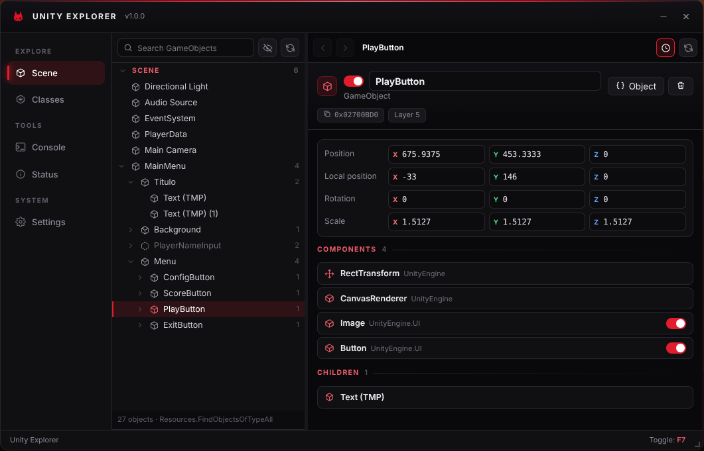
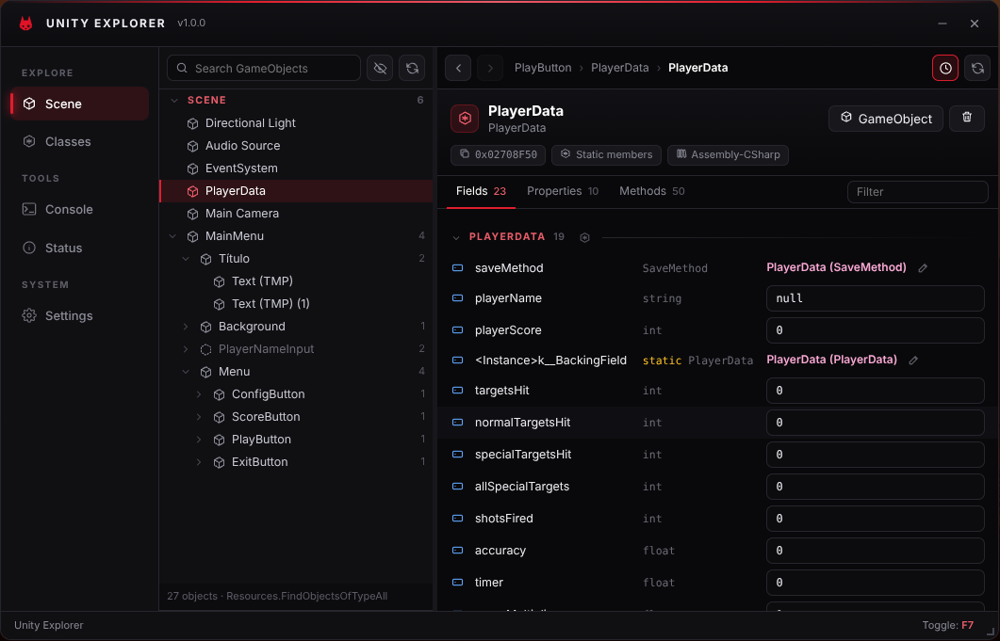
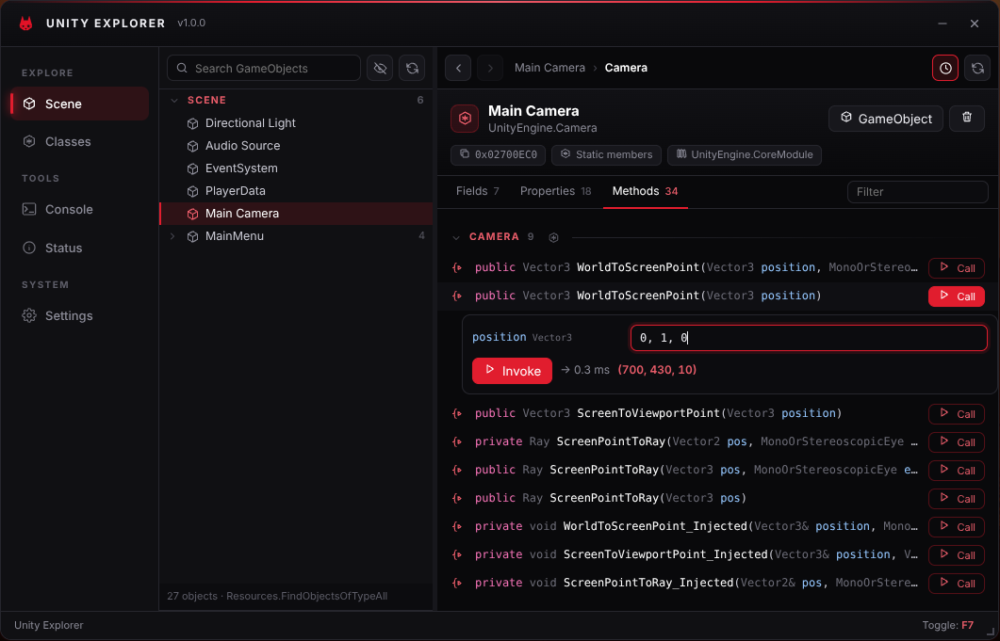
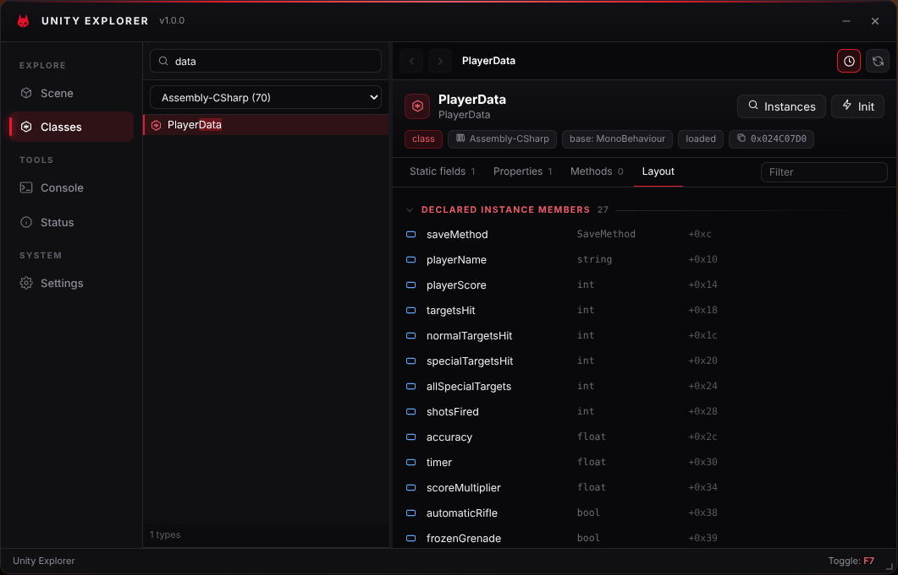
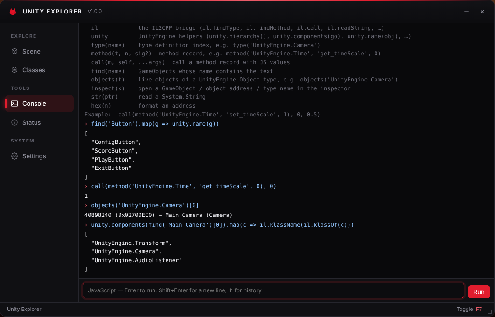

<div align="center">


# Unity Explorer

**A runtime explorer for Unity WebGL games. Browse the scene, inspect any object, edit fields live and call methods, straight from a userscript.**




</div>

## Table of Contents

- [Features](#features)
- [Screenshots](#screenshots)
- [Install](#install)
- [Using it](#using-it)
- [Typing values](#typing-values)
- [Console](#console)
- [How it works](#how-it-works)
- [Compatibility](#compatibility)
- [Limitations](#limitations)
- [Building](#building)
- [Project structure](#project-structure)
- [Credits](#credits)
- [License](#license)

## Features

- **Scene hierarchy.** Every GameObject in a searchable tree, with inactive and hidden objects marked and prefabs that aren't in a scene grouped separately.
- **GameObject view.** Rename, toggle active, destroy, edit position, rotation and scale, enable or disable components, and jump to children.
- **Inspector.** Fields, properties and methods of any object, grouped by class with inherited members included. Values update live.
- **Live editing.** Numbers, strings, bools, enums (as a dropdown), vectors and other small structs, and object references.
- **Collections.** Arrays, `List<T>` and `Dictionary<K,V>` expand inline or open in an Elements tab.
- **Method calls.** Call any non-generic method, static or instance. `ref` and `out` results are shown, and returned objects can be opened. Managed exceptions are caught and shown as text instead of crashing the game.
- **Class browser.** Every type in every assembly, with static fields, static properties and methods, constants, enum values and nested types. **Instances** finds live objects of a type.
- **Console.** A JavaScript REPL with the bridge in scope, for anything the UI doesn't cover.
- **Odium UI.** A black-and-red window that you can drag and resize, toggled with <kbd>F7</kbd>. Keystrokes typed into it never reach the game.

## Screenshots

| | |
| --- | --- |
|  **Inspector**: fields of a component, with static members and constants |  **Methods**: call with arguments and see the result |
|  **Classes**: search every type, its statics and its memory layout |  **Console**: script the game from JavaScript |

## Install

1. Install a userscript manager, either [Tampermonkey](https://www.tampermonkey.net/) or [Violentmonkey](https://violentmonkey.github.io/).
2. Open `dist/unity-explorer.user.js` and install it.
3. Load a Unity WebGL game. The window appears once the game has started. Press <kbd>F7</kbd> to show or hide it.

The script matches every site, but it only shows up on pages that run a Unity WebGL build. To limit it to one game, change `@match` in the header, for example `// @match https://example.com/game/*`.

> [!TIP]
> The script runs at `document-start` so it can attach to the game as it boots. If it's injected later, it still finds the running game through the usual globals (`unityInstance`, `gameInstance` and so on).

## Using it

**Scene**: pick a GameObject on the left.
- The right side shows its transform, its components (click one to inspect it) and its children.
- **Object** opens the GameObject's own managed fields and methods.
- The eye button shows hidden objects. Refresh rebuilds the tree after the game loads a new scene.

**Inspector**: the tabs are **Fields**, **Properties**, **Methods** and, for collections, **Elements**.
- Members are grouped by the class that declares them.
- Click a type name to open its static view. Click an object reference to follow it, and use the arrows or the breadcrumb to go back.
- Edit a value and press <kbd>Enter</kbd>; <kbd>Esc</kbd> cancels.
- The clock button pauses live updates.

**Properties** run a getter, which is game code. By default, getters on engine types (`UnityEngine.*`, `System.*`, `TMPro.*`) are evaluated automatically, while getters on game types wait for you to click **Get**. You can change this under **Settings → Inspector**.

**Classes**: search by name, optionally limited to one assembly (`Assembly-CSharp` is selected first).
- **Instances** lists live objects of the type.
- **Init** runs the static constructor of a class that hasn't been loaded yet.
- **Instance members** lists the declared layout, with field offsets.

**Status** shows what was detected. **Copy diagnostics** puts a report on your clipboard for bug reports.

## Typing values

| Type | Examples |
| --- | --- |
| numbers | `42`, `-1.5`, `0x1F` |
| `bool` | `true`, `false`, `1`, `0` |
| `string` | `hello`, `"quoted text"`, or `null` |
| enums | `Skybox`, `Fire \| Reload`, or the number |
| small structs (`Vector3`, `Color`, `Rect`, …) | `1, 2, 3`, comma or space separated, in field order |
| object references | `null`, or an address such as `@0x02700EC0` (click an address chip to copy it) |
| `System.Type` | a type name: `UnityEngine.Camera` |
| `out` parameters | leave empty |

## Console

The console evaluates JavaScript with these in scope:

```js
type('UnityEngine.Camera')                          // type definition index
method('UnityEngine.Time', 'set_timeScale', 1)      // method record (name + parameter count or types)
call(method('UnityEngine.Time', 'set_timeScale', 1), 0, 0.5)   // static call: self = 0
find('Player')                                      // GameObjects whose name contains "Player"
objects('UnityEngine.Camera')                       // live objects of a UnityEngine.Object type
inspect(find('Player')[0])                          // open in the inspector
str(ptr)                                            // read a System.String
il, unity                                           // the full bridge, see src/il2cpp
```

The same objects are available on the page as `window.UnityExplorer` (`.il`, `.unity`, `.inspect()`).

## How it works

Unity WebGL builds strip the `il2cpp_*` API, so the explorer works from the build's own data:

1. **Module.** A `document-start` hook catches the Emscripten `Module` when the framework assigns `Module.asm`. That gives access to the wasm memory, the function table, `malloc` and the stack helpers.
2. **Metadata.** The runtime keeps `global-metadata.dat` in the heap. It's found by its `0xFAB11BAF` magic and supplies the names of every assembly, type, field, method, parameter and property. Record sizes are derived from section sizes, so v29 and v31 layouts are both handled.
3. **Registrations.** `Il2CppCodeRegistration`, found through the `mscorlib.dll` module name, maps each method token to its wasm table index. `Il2CppMetadataRegistration`, found by its shape, holds every `Il2CppType`, the field offsets and the type sizes.
4. **Calibration.** The bridge allocates a `System.String`, then locates `name`, `parent`, `fields`, `static_fields` and the class table inside `Il2CppClass` by matching what it already knows about `String`, `String.Empty` and `Object`. Nothing is hard-coded per Unity version.
5. **Calls.** Managed methods are called directly through the function table using IL2CPP's convention: `(sret?, this?, ...args, MethodInfo*)`.
   - Structs follow the wasm32 C ABI: passed by pointer, except single-field structs, which are passed by value.
   - `long` is passed as a BigInt.
   - The function's arity is checked before every call.
   - Managed exceptions arrive as C++ throws; they're caught, the stack pointer is restored, and the exception's message is read.
6. **Scene.** GameObjects come from `FindObjectsOfType`, `FindObjectsByType` or `Resources.FindObjectsOfTypeAll`, whichever survived stripping. A heap scan is the last resort.

## Compatibility

Works with Unity **2021.2 through 6000.x** WebGL builds, which use IL2CPP metadata v29 and v31. It was tested end to end on:

| Build | Unity | Metadata | Scene API found |
| --- | --- | --- | --- |
| Enhanced Shots | 2021.3.29f1 | v29 | `Resources.FindObjectsOfTypeAll` |
| The Invasion Reforged | 6000.2.8f1 | v31 | `FindObjectsByType` |

Bullet Force (2022.3.62f3) was checked against its wasm: the code and metadata registrations, every code module (Assembly-CSharp, FishNet, Bayou, …) and their method pointer tables resolve correctly.

## Limitations

- **Generic methods and methods of generic types** (`List<T>.Add`) are listed but can't be called. Their code lives in shared generic tables that aren't mapped yet.
- **Stripped code can't be called.** If the game never used a method, the build doesn't contain it, and the inspector says so. Engine helpers fall back automatically.
- **Generic struct parameters** (`Nullable<T>`, `KeyValuePair<K,V>`) aren't supported as arguments. They can still be read.
- **Thread-static fields** aren't shown.
- **Property getters and method calls run game code.** They can have side effects, and a bad argument can throw (which is caught) or, rarely, trap the wasm.
- **Encrypted metadata.** Builds that encrypt their metadata still work as long as it's decrypted in memory, which it has to be for the game to run. Builds that rewrite the metadata format won't.

## Building

The build needs [Bun](https://bun.sh/) and nothing else:

```bash
bun scripts/build.js             # minified -> dist/unity-explorer.user.js + dist/unity-explorer.js
bun scripts/build.js --readable  # unminified, for debugging
```

`dist/unity-explorer.js` is the same code without the userscript header. It's useful for injecting from the console or from another script before the game loads.

## Project structure

```
unity-explorer/
├── src/
│   ├── main.js            app: window, tabs, status, settings
│   ├── hook.js            document-start hooks: Module capture, key shield
│   ├── il2cpp/
│   │   ├── memory.js      heap views and scanning
│   │   ├── metadata.js    global-metadata reader (v24.2 – v31)
│   │   ├── registration.js  code / metadata registration finder
│   │   ├── runtime.js     the bridge: types, classes, fields, calls, strings
│   │   ├── unity.js       UnityEngine helpers with fallbacks for stripped APIs
│   │   ├── values.js      value formatting and input parsing
│   │   └── types.js       Il2CppTypeEnum and attribute flags
│   ├── ui/
│   │   ├── scene.js       hierarchy tree + inspector
│   │   ├── classes.js     type browser + static inspector
│   │   ├── inspector.js   fields / properties / methods / elements
│   │   ├── console.js     JavaScript REPL
│   │   ├── vlist.js       virtualised list
│   │   ├── icons.js       line icons
│   │   └── explorer.css
│   └── odium/             Odium UI (vendored)
├── scripts/build.js
├── userscript.config.json userscript header
└── dist/
```

## Credits

Made by **Nyxi**. The UI is [Odium UI](https://github.com/oddnyxi/odium-ui). The metadata layouts were cross-checked against [Il2CppDumper](https://github.com/Perfare/Il2CppDumper).

## License

[MIT with attribution](LICENSE.md). © 2025-2026 Nyxi.
# odium-ue

